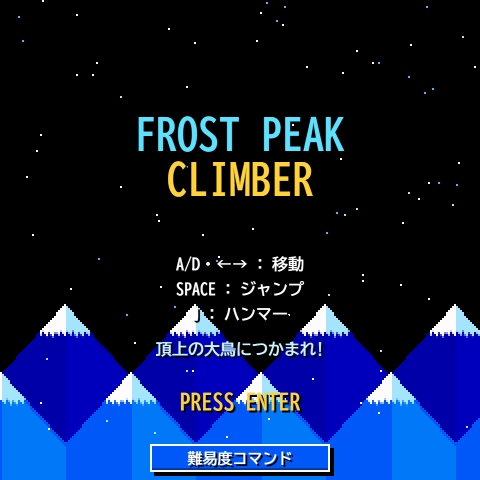
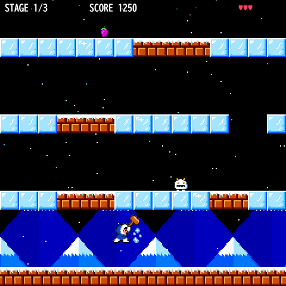
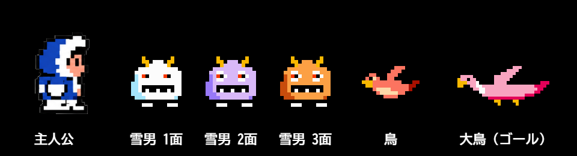
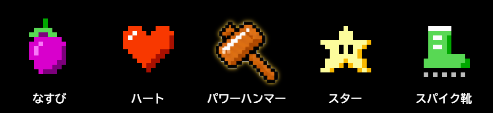
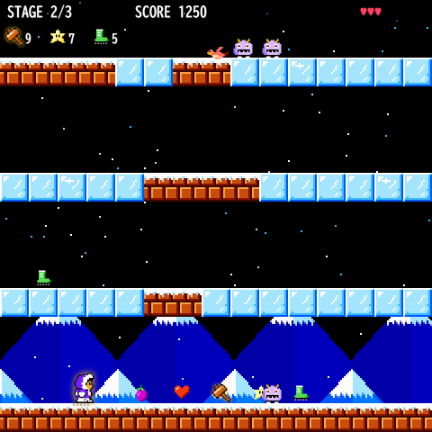

# ❄️ Frost Peak Climber

<b>▶ <a href="https://kdt26aie40008-ux.github.io/-/">ブラウザで今すぐ遊ぶ</a></b>

氷の山を下から上へ登っていく、ファミコン風ドット絵のアクションゲームです。
ハンマーで氷を割り、雪男や鳥をかわしながら、山の頂上を飛ぶ **大鳥** につかまればステージクリア！
全3ステージをクリアするとゲームクリアです。

---

## ▶️ 遊び方

1. 上の **「ブラウザで今すぐ遊ぶ」** を開く（または `index.html` をダブルクリック）
2. **ENTER** を押してスタート
3. 氷を割りながら上へ上へと登り、頂上の大鳥にタッチする

> キーボードで遊ぶゲームです。スマホでは操作できません。

---

## 🎮 操作方法

| キー | 動作 |
|---|---|
| **A / D** または **← / →** | 左右に移動 |
| **SPACE** | ジャンプ |
| **J** | ハンマーをふる |
| **ENTER** | ゲーム開始 / リトライ |

### ジャンプのルール
- ジャンプできるのは **地面や雲の上に立っているときだけ** です。空中ジャンプ（二段ジャンプ）はできません。
- 着地の少し前（0.2秒以内）に SPACE を押しておくと、**着地した瞬間にすぐ次のジャンプ** が出ます。
- **続けて3回ジャンプすると、2秒間ジャンプできなくなります**。主人公がしゃがみ、画面に「ジャンプ不可」と残り秒数が出ます。
- 1.5秒ほどジャンプしないでいると、回数はリセットされます。
- 空中では向きや横の速さを変えられません。跳ぶ前に方向を決めましょう。

### ハンマー
- 地上でふると、**前にいる敵を倒し、前の氷ブロックを割り** ます。
- 空中でふると、**頭の上** にも攻撃が届きます。
- 下からジャンプして頭をぶつけても、氷ブロックを割れます。

---

## 🗺️ ステージのしくみ

| 足場 | 特徴 |
|---|---|
| **氷** | 上に乗ると **ツルツル滑って止まれません**。ハンマーや頭突きで壊せます。 |
| **岩** | 滑らない安全な足場。壊せません。 |
| **雲** | 左右に動く足場。乗ると一緒に運ばれます（ステージ2・3の頂上付近）。 |

- 画面の **左右の端はつながっています**。右へ出ると左から出てきます。
- 新しい階に着地すると、画面が上にスクロールします。
- 画面の下に落ちると体力が1減り、一番高く登った階に戻されます。

| ステージ | 階数 | 敵の多さ・速さ | 動く雲 |
|---|---|---|---|
| 1 | 7階 | ふつう | なし |
| 2 | 9階 | 多い・速い | 1段 |
| 3 | 11階 | とても多い・とても速い | 2段 |

---

## 👾 キャラクター

| キャラ | 説明 |
|---|---|
| **主人公** | 青いフードの氷の冒険者。ハンマーで戦います。体力は3からスタート（最大5）。 |
| **雪男** | 床を歩き回る敵。ぶつかると体力が1減ります。**氷を運んできて穴をふさいでしまう** ので注意！ステージごとに白→紫→オレンジと色が変わり、速くなります。 |
| **鳥** | 空中を波のように飛び回る敵。ぶつかると体力が1減ります。 |
| **大鳥** | 頂上を左右に飛んでいるゴール。**つかまればステージクリア！** |

敵にぶつかると主人公は倒れ、少しの間点滅します。点滅中は無敵です。
体力が0になるとゲームオーバー。ENTER でリトライできます。

---

## 🎁 アイテム

階のどこかにランダムで置かれています。触れると取れます。

| アイテム | 効果 | 時間 |
|---|---|---|
| 🍆 **なすび** | +300点 | − |
| ❤️ **ハート** | 体力が1回復（最大5） | − |
| 🔨 **パワーハンマー** | 体が金色に光り、ハンマーの **届く範囲が2倍** | 10秒 |
| ⭐ **スター** | **無敵**。体が虹色に光り、触れた敵を倒せる | 8秒 |
| 👢 **スパイク靴** | 氷の上でも **滑らない**（足元にトゲが付く） | 10秒 |

効果中のアイテムは、画面左上にアイコンと残り秒数が表示されます。

---

## 🏆 スコア

| 行動 | 得点 |
|---|---|
| 氷ブロックを割る | +10 |
| 敵を倒す | +100 |
| アイテムを取る（なすび以外） | +100 |
| なすびを取る | +300 |
| 大鳥につかまる（ステージクリア） | +3000 |

---

## 🤫 隠しコマンド

ゲーム中に **矢印キー** で入力すると発動します。便利ですが、ペナルティがあるものも…？

| コマンド | 効果 | ペナルティ |
|---|---|---|
| ↑ ↑ ↓ ↓ → ← → ← | **10秒間無敵** | 切れたあと **5秒間、敵に触れると即死** ☠ |
| ↑ → ← ↓ | **10秒間ハンマー強化** | なし |
| ↑ ↓ → → ← ← ↑ ↓ ↓ ← → | **10秒間すべての敵が消える** | 10秒後、**敵が2倍になって戻ってくる** |

- 入力を間違えても、最初から打ち直せば発動します。
- 3つのコマンドは同時に使えます。

---

## ⚙️ 難易度設定

隠しコマンドではなく、正式な難易度設定です。**タイトル画面でもゲーム中でも** 矢印キーで入力できます。

| コマンド | 難易度 | 内容 |
|---|---|---|
| → ↓ ← ↑ → ↓ ← ↑ | **難易度3** | ① **10秒間無敵 → 5秒間即死** をずっと繰り返す ② **画面が自動で上がっていく** ③ 置いていかれて画面の下に消えると **即死** ☠ |

- タイトル画面の **「難易度コマンド」ボタン** をクリックすると、コマンド表と現在の難易度を確認できます（クリック / ENTER / ESC で閉じる）。
- 設定中はタイトル画面の右上に「難易度 3」、ゲーム中は画面上に赤い「難3」が表示されます。
- もう一度同じコマンドを打つと、ふつうの難易度に戻ります。
- ステージが変わっても、リトライしても、設定はそのまま続きます。

操作とコマンドの早見表は [COMMANDS.md](COMMANDS.md) にもまとめています。

---

## 💡 攻略のコツ

- 氷の上では止まれないので、**岩の足場** を目印に動きましょう。
- 頭上の氷を割って穴をあけると、上の階へ登れます。雪男がふさぐ前に急いで！
- ジャンプは続けて3回まで。大事なジャンプの前は **少し立ち止まって** 回数をリセットしましょう。
- スパイク靴があれば、氷の階もスイスイ進めます。
- 難易度3では、無敵の10秒間のうちにできるだけ登っておきましょう。

---

## 📁 ファイル構成

| ファイル | 内容 |
|---|---|
| `index.html` | ゲーム本体（これ1つで動きます） |
| `images/sprites/` | 主人公とハンマーのドット絵（素材集から切り出したもの） |
| `images/氷の冒険者とハンマーの8ビット素材集.png` | 主人公とハンマーの元の素材集 |
| `images/*.png` | この README で使っている画像 |
| `COMMANDS.md` | 操作・コマンドの早見表 |
